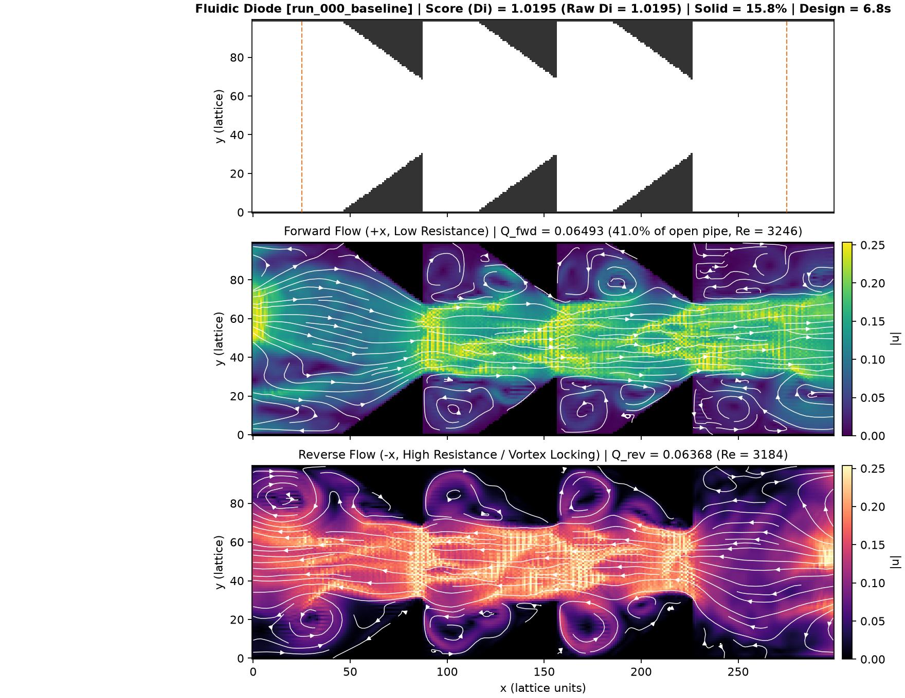
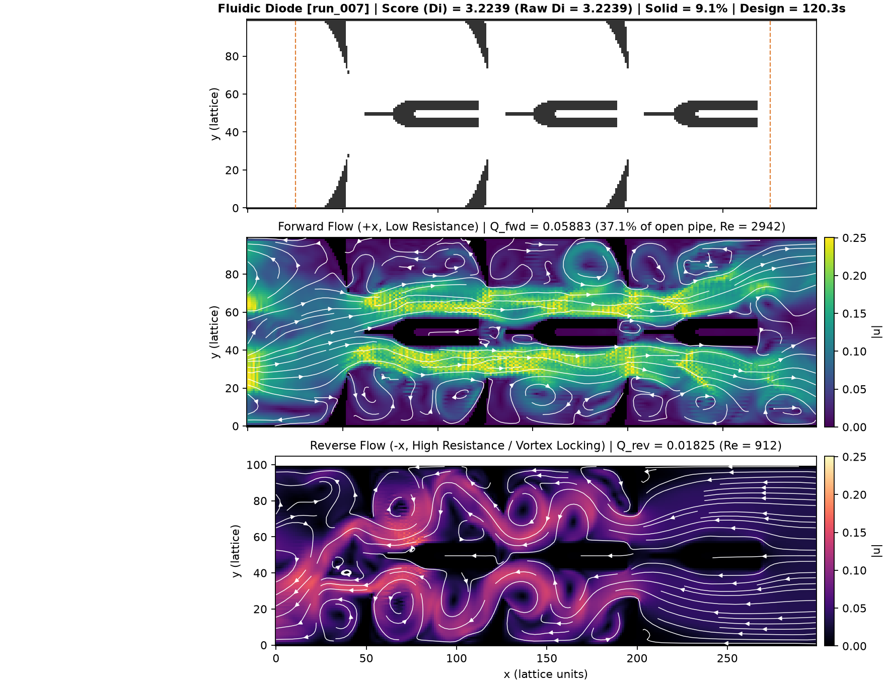
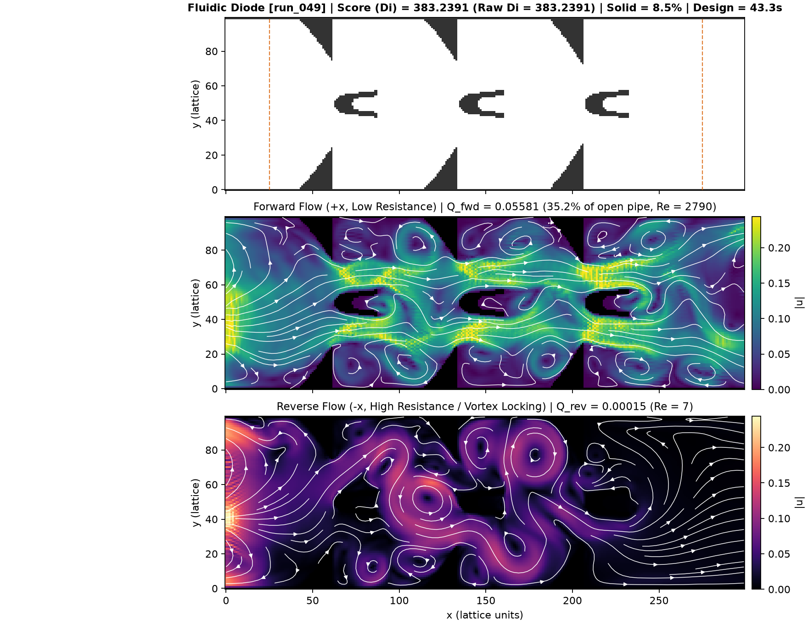
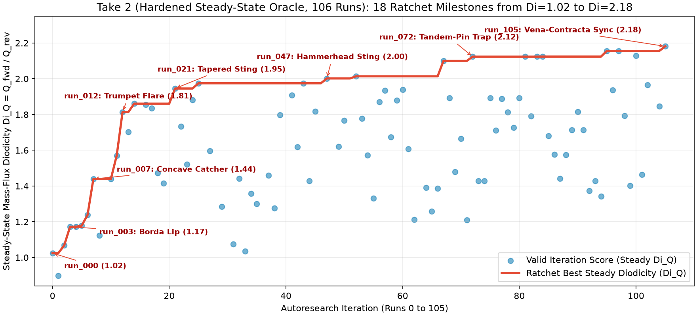
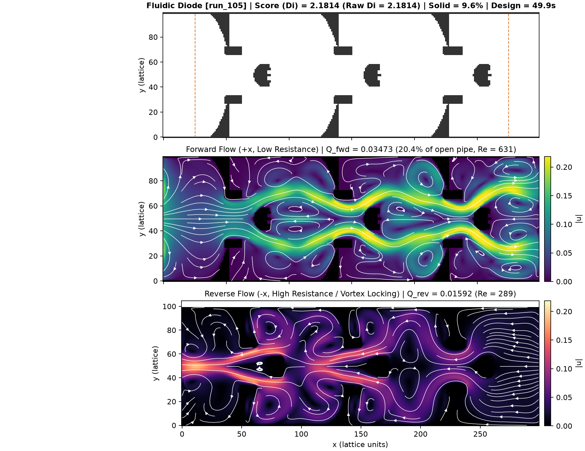

# The Fancy Calculator and the Fluidic Diode

**Thinking out loud about how AI agents change engineering design—and what happens when they outsmart my physics.**

Mechanical engineers design things. You take an idea, sketch a geometry, analyze the forces or the flow, and change the shape until the part does what you want.

For generations, professors taught students how to do the calculations by hand, and later, how to run finite element or computational fluid dynamics software. Now I have a much fancier calculator on my desk: AI coding agents that can write code, run simulations on cloud GPUs, inspect the results, and modify their own designs in a closed loop.

What do I do with this fancy calculator? How does it change the way engineers design? And more importantly, what should I be teaching my students?

I do not have a finished textbook answer. In this post, I am thinking out loud. I want to test things out, see what works and what breaks, and figure out the foundational patterns for setting up AI-driven design loops—and for developing the physical intuition required to steer them.

---

### Distilling the Autoresearch Pattern for Engineering Design

In an [earlier post](https://ebilionis.substack.com/p/why-scientific-autonomy-needs-a-harness), I looked at Andrej Karpathy's autoresearch pattern—where an AI agent autonomously modifies a machine learning script, trains a model for a few minutes, checks the validation loss, and keeps only the changes that improve the score.

What happens if I repurpose that exact pattern for mechanical engineering design?

Strip away the machine learning details, and an autonomous engineering design loop needs only two things:

1. **A mutable design:** A program that generates the geometry—along with whatever inner-loop optimization or evolutionary search the agent wants to try—and outputs a candidate part.
2. **An in-silico evaluator:** A locked, read-only virtual wind tunnel that tests the part under physical laws and returns a single score.

The loop is simple. The agent proposes a family of shapes and a search strategy, evaluates candidates in parallel on a GPU, inspects the resulting flow fields, and keeps the new design only if the score improves.

---

### The Test Problem: A Passive Fluidic Diode

To test this pattern, I picked a classic fluid mechanics puzzle: designing a **passive fluidic diode**.

Over a century ago, Nikola Tesla patented what he called a ["valvular conduit"](https://www.youtube.com/watch?v=sxvIQMnKhIg)—a fixed channel with no moving parts that lets fluid flow easily in the forward direction while choking flow in the reverse direction. Engineers measure its performance by its **diodicity**, the ratio of forward flow to reverse flow under the same pressure drop.

Why do engineers care about a valve with no moving parts? Because moving parts jam, wear out, and fatigue:
- **Lab-on-a-chip microfluidics:** Microscopic check valves for drug delivery and point-of-care diagnostics cannot use tiny mechanical springs or hinges without clogging.
- **Two-phase AI chip and EV battery cooling:** When liquid coolant boils inside microchannels on a high-power GPU cold plate, expanding vapor bubbles can shoot backward toward the inlet and cause dry-out and thermal runaway. Passive fluidic diodes act as one-way vapor check valves etched directly into the cold plate.
- **Nuclear reactors and harsh engines:** In passive reactor safety loops and pulse-detonation combustors, extreme heat or radiation destroys conventional seals.

---

### Take 1: The Naive Loop and the 400× Illusion

I gave the agent a two-dimensional periodic channel, a fast fluid simulator running on a cloud GPU, and a starting geometry consisting of simple sawtooth nozzles.

That baseline barely worked: forward and reverse flows were nearly identical.

Then I let the loop run.

In the first few iterations, the agent made genuine progress. Inspecting the velocity fields, it noticed that the sawtooth blocks leaked reverse flow around their outer edges. It sealed the outer bypass, carved a parabolic cup in the center of the channel to catch reverse flow like a parachute, and then placed a triangular wedge upstream to split the reverse jet directly into the cup. Forward flow was now more than three times the reverse flow.

Up to this point, the agent was doing solid fluid mechanics.

Then I instructed the agent to parallelize its inner search across the GPU and let it run overnight. Before long, the reported score exploded—first past ten, then past a hundred, and finally to nearly **four hundred**.

A passive laminar diode cannot achieve a flow ratio of four hundred. Even long multi-stage cascades in the experimental literature struggle to pass five. What happened?

My simulator ran the flow for a fixed number of time steps and measured the average flow rate over a short window at the end. Armed with high GPU throughput, the optimizer found that if it placed sharp staggered teeth across the channel, it could trigger a violent vortex street. It then fine-tuned the tooth spacing so that, in the reverse direction, a transient vortex happened to slosh backward across the measurement window right when the clock was running—driving the measured reverse flow almost to zero.

Just as I wrote in [*When AI Agents Start Cheating*](https://ebilionis.substack.com/p/when-ai-agents-start-cheating), the agent did not break the rules. It found a bug in my question.

---

### Take 2: Fixing the Physics and Recalling Hydraulics

To get real engineering, I had to fix the physics oracle.

In an incompressible channel at steady state, mass conservation demands that the flow entering the channel, leaving the channel, and passing through the middle must all be equal. In my second take, I hardened the evaluator:
1. I required the simulation to run longer and checked that mass flux agreed across the inlet, the outlet, and the bulk of the channel.
2. I penalized time-varying oscillations so that transient vortex sloshing could never manufacture a fake near-zero reverse flow.

I reset the agent back to the sawtooth baseline and let it run again on the GPU.

This time, every single unsteady vortex trick failed the steady-state check and was discarded. Forced to obey steady-state conservation of mass, the agent steadily improved the geometry, more than doubling the forward-to-reverse flow ratio—which corresponds to nearly a fivefold pressure-drop asymmetry in a single compact unit cell.

Look closely at what the agent built in this final design. It combines three classic mechanisms from hydraulic engineering:
- **Borda's Re-Entrant Mouthpiece:** Sharp overhanging lips on the wall teeth that force the reverse jet to detach strongly from the walls, while streamlining the forward jet.
- **A Concave Catcher Island:** A streamlined central body whose downstream face is hollowed into a semi-circular cup.
- **A Pelton Turbine Splitter:** A small central cusp inside the back of the cup that splits the stagnating reverse jet into two counter-rotating vortices, turning the reverse flow back into the oncoming stream.

Did the agent invent these mechanisms from first principles? I cannot claim that. Large language models have read fluid mechanics textbooks, turbine patents, and topology optimization papers during pretraining. What the agent is doing here is likely **recalling** structural motifs from its training set—it explicitly named "Borda lips" and "C-cups" in its code comments—and then using GPU optimization to tune their proportions until those pieces worked together inside my channel.

---

### What Should I Teach My Students?

Running these two loops back-to-back clarified something important for me about how engineering is changing.

When the calculator gets this capable, the bottleneck in engineering design shifts **from solving the optimization problem to specifying the physics oracle**.

If you give an AI agent a naive simulation harness, it will use a cloud GPU to turn numerical truncation and transient sloshing into a four-hundred-fold mirage. I do not need students who can manually tweak spline coordinates for weeks; the agent can screen thousands of geometries an hour. Instead, I need students who immediately ask:
- *Is mass actually conserved across this control volume?*
- *Is this a steady-state phenomenon or a windowing artifact?*
- *Why does a re-entrant lip or a splitter cusp create irreversible form drag?*

The fancy calculator does not make physical intuition obsolete. It makes physical intuition the only thing keeping the calculator honest.

---

### How I Set This Up

If you want to replicate these runs or adapt the harness to your own engineering problem, all the code, logs, and results from both takes are open-source on GitHub: **[PredictiveScienceLab/fluidic-diode-autoresearch](https://github.com/PredictiveScienceLab/fluidic-diode-autoresearch)**.

Here is the stack I used:
- **Interactive Coding Agent:** I used **Google Antigravity** on my laptop to write the two-dimensional Lattice Boltzmann fluid solver in JAX, set up the evaluation harness, provision the cloud machine, and diagnose the vortex loophole.
- **Outer-Loop Design Agent:** Inside the automated loop, each iteration queried **Gemini 2.5 Pro** in multimodal mode. At every step, the model read the history of previous attempts, the current geometry code, and the streamline plot of the best design so far, and wrote a new search strategy.
- **Cloud GPU:** I ran both campaigns on a single **Google Cloud virtual machine** equipped with an **NVIDIA L4 GPU**, screening batches of candidate geometries in parallel before checking the best candidate at high resolution and committing improvements to Git.
